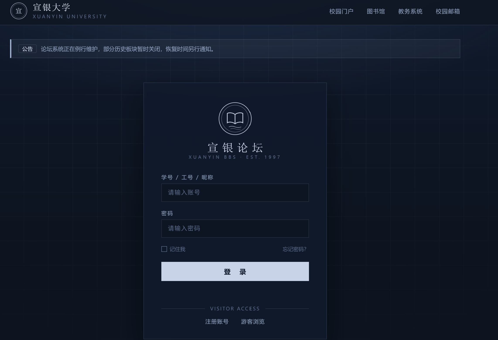
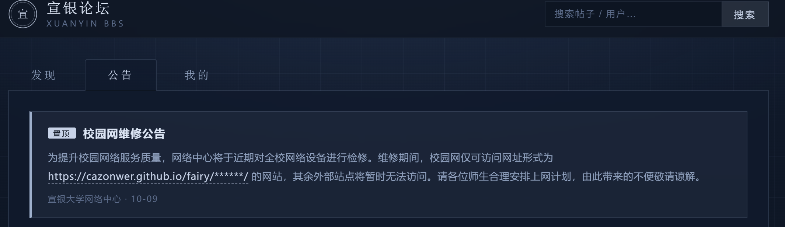
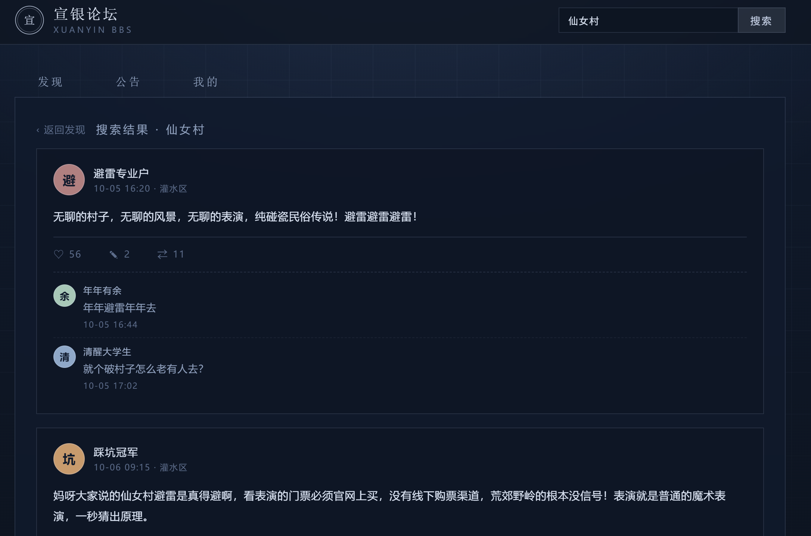
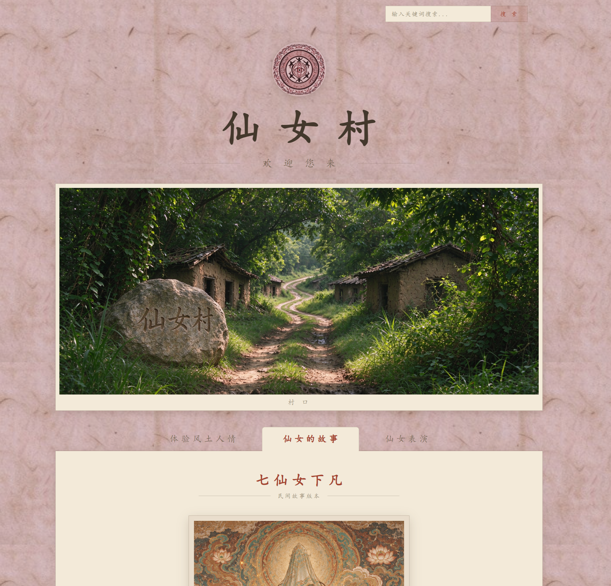
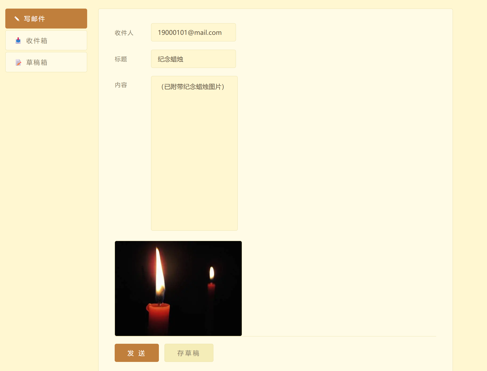
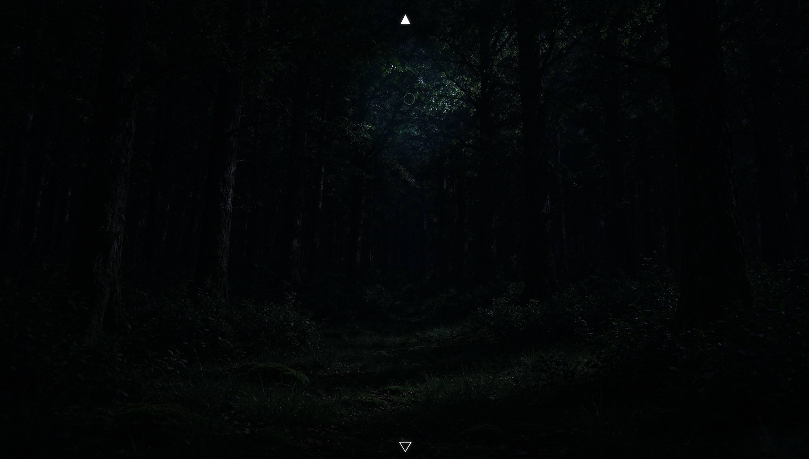
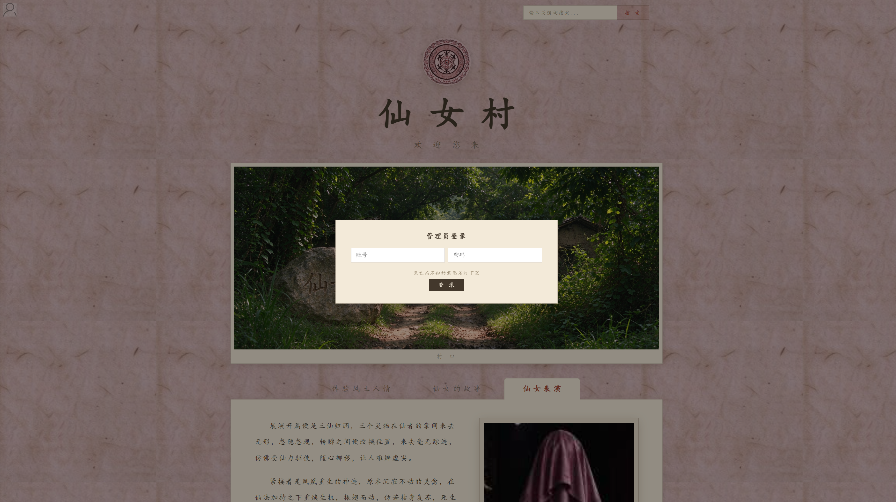
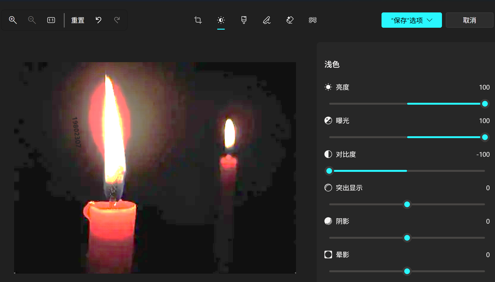

# 
仙女下凡攻略

&nbsp;

## 周水主线：
网址:https://cazonwer.github.io/fairy/xuanyin-bbs/

1.点击账号和密码的输入框，根据提示直接填写即可进入论坛。

2.浏览帖子内容与评论，景点名称疑似“仙女村”，继续浏览。

3.浏览帖子内容与评论，提取信息：邮箱帐号为出生日期，密码疑似乱码未知。

4.由置顶公告得到信息：仅形式为https://cazonwer.github.io/fairy/******/ 的网址可用

5.在“我的”模块中查看“我的帖子”，观察帖子的发布日期结合文案，得到线索：“我”的生日为2006年9月21日
.png)

6.搜索框检索“仙女村”，提取信息:表演门票需要在景点官网购买，根据生活经验以及置顶公告的提示可知景点官网地址为https://cazonwer.github.io/fairy/xiannvcun/

7.修改网址后缀并跳转，进入“仙女村”官网首页

8.鼠标靠近页面左侧触发隐藏导航栏，点击查看“近期新闻”
.png)

9.查看“仙女首次表演”新闻详情，获得关键信息“董荣”
.png)

10.搜索栏检索“董荣”
.png)

11.点进“董荣”详情页，浏览内容，获得邮箱地址，下载纪念蜡烛图片
.png)

12.由生活经验与置顶公告可得邮箱地址为：https://cazonwer.github.io/fairy/youxiang/ ，输入网址并跳转
.png)

13.由步骤1、3、5得到邮箱账户为20060921，密码为zhoushui1108，登录成功进入邮箱，点击各个输入框，弹出提示，依次点击文本填充预设内容（注意：非预设内容发送邮件不会有任何线索！）
.png)
正确完整邮件如下：

14.点击发送后，耐心等待2秒，收到回信
.png)

15.点击董荣日记其一，进入详情页，获得线索：柳小小
.png)

16.转到仙女村网页:https://cazonwer.github.io/fairy/xiannvcun/ 搜索框检索“柳小小”，新邮件提示音响起，右下角弹出提示框
.png)

17.跳转邮箱界面https://cazonwer.github.io/fairy/youxiang/ 登录周水邮箱，查看新邮件。通过网络得到收件人Sähköpostin salasana的翻译为“电子邮箱密码”
.png)

18.查看“柳小小”详情页，根据字条内容“目察百步，不能了了，而欲以所见为有，所不见为无，则天下之所无者，亦必多矣。”意为“看不到的不代表不存在”，提示页面中有隐藏内容。选中页面上的所有字，得到新网址：https://cazonwer.github.io/fairy/jiyi/
.png)

19.跳转至https://cazonwer.github.io/fairy/jiyi/ ，需要密码，密码提示为“看着他的脸”。
.png)

20.男人人像图片仅有“董荣”介绍中的“董荣肖像”，转至仙女村网页搜索“董荣”，进入详情页，观察肖像中的黑块，得到摩斯密码：

“.-- &emsp; - &emsp; -..- &emsp; - &emsp; .-.”

&nbsp;

通过网络得到翻译结果为：m t x t r
.png)

21.转到https://cazonwer.github.io/fairy/jiyi/ ，输入密码：mtxtr
看到闪过字幕：“壬申年五月廿三丑时”——“董荣”——“山上”——“寻找手绢”
进入寻找手绢环节，首次进入请耐心等待图片加载，移动鼠标寻找手绢，点击实心正三角为向前一个场景，点击空心倒三角为向后一个场景。

22.{恐怖图片提醒}向前第三个场景右下角边缘，点击手绢，与“仙女”相遇（如有需要请调高亮度）
.png)

23.“仙女正在看着你”过场动画后回到邮箱界面，耐心等待2秒，收到新邮件“董荣日记其二”
.png)
点击查看详情，根据日记日期“壬申年五月廿四”和内容“昨夜”，得到仙女降临时间为：壬申年五月廿三；通过网络得到壬申年可能为1872、1932、1992……，结合步骤11“董荣”详情页中董荣的出生年份1900，得到此处壬申年指1932年，查看日历，1932年农历五月廿三对应的公历日期为6月26日，综上得到仙女的降临日期为公历1932年6月26日
.png)
24.结合步骤17中收到的"电子邮箱密码"以及降临日期“1932年6月26日”，可以猜测“仙女”邮箱账号为“19320626”，输入账号，得到密码框内提示“左袖口”
.png)
回到周水邮箱查看Sähköpostin salasana的邮件图片，在图片人物的左袖口附近找到文本“密码是5399”。
.png)
25.输入仙女邮箱账号“19320626”，密码“5399”，进入仙女邮箱。浏览草稿箱的草稿邮件。
&nbsp;

根据无标题草稿邮件中的内容得知“仙女”并不属于地球与其内心复杂的情感。
.png)

根据“别忘了来看”邮件得到支付凭证码“AET806ZK”
.png)

26.跳转至仙女村网页https://cazonwer.github.io/fairy/xiannvcun/ 在“仙女表演”板块，点击“购买”按钮，输入支付凭证码“AET806ZK”
.png)
27.点击门票
.png)
28.看到“感谢游玩”，意为主线游戏结束。
.png)
&nbsp;

&nbsp;

&nbsp;
## 管理员支线：
1.跳转至仙女村网页https://cazonwer.github.io/fairy/xiannvcun/ ，点击页面左上角小人图标，弹出管理员登录界面，小字提示"见之而不知的意思是灯下黑"，“见之而不知”猜测管理员登录账号为“guanliyuan”，

由“灯下黑”，找到下载的纪念蜡烛图片，调高亮度，曝光，调低对比度，得到密码“89771”

2.输入账号密码即可进入管理员登录状态，鼠标靠近页面左侧，弹出隐藏导航栏，看到“仙女档案”，需要密码。

&nbsp;搜索框搜索“仙女”得到结果“防忘”。
.png)
进入详情页得到一串数字“89771”。猜测密码为“89771”。
.png)
两处验证密码均为“89771”
.png)
.png)
3.进入仙女档案，得知非地生命“仙女”正在被未知组织监视。（支线剧情结束）
.png)

&nbsp;

# 
感谢游玩！期待您的反馈！
